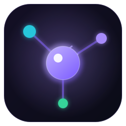
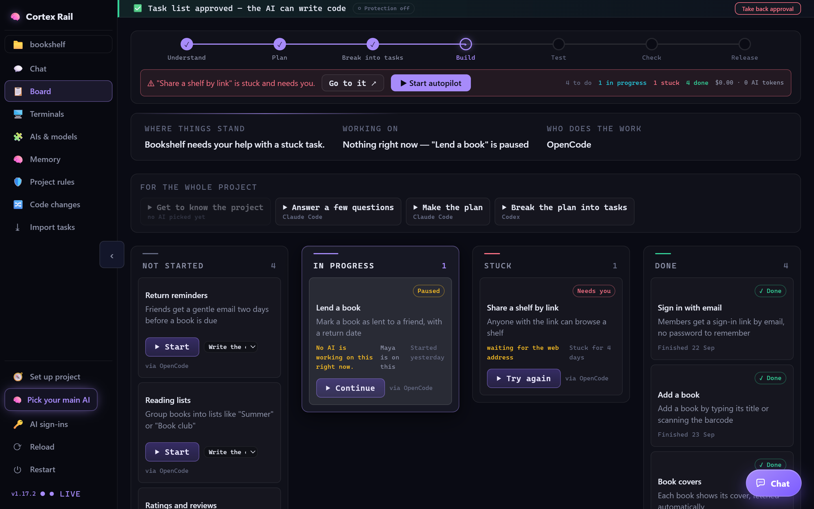
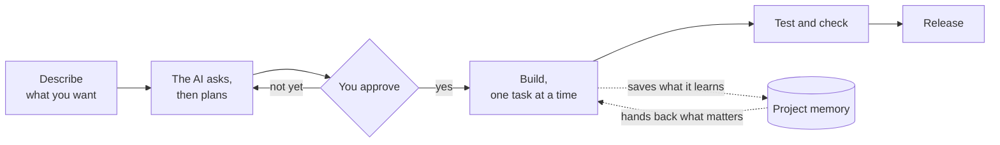
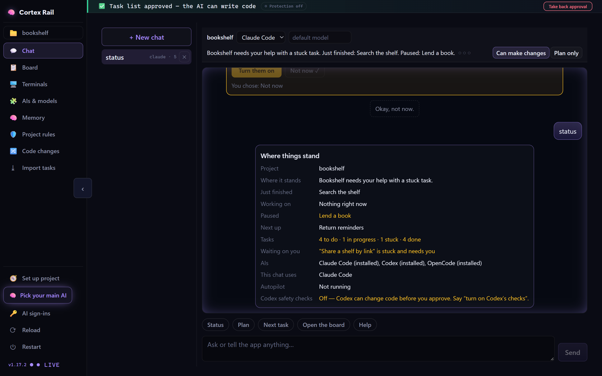
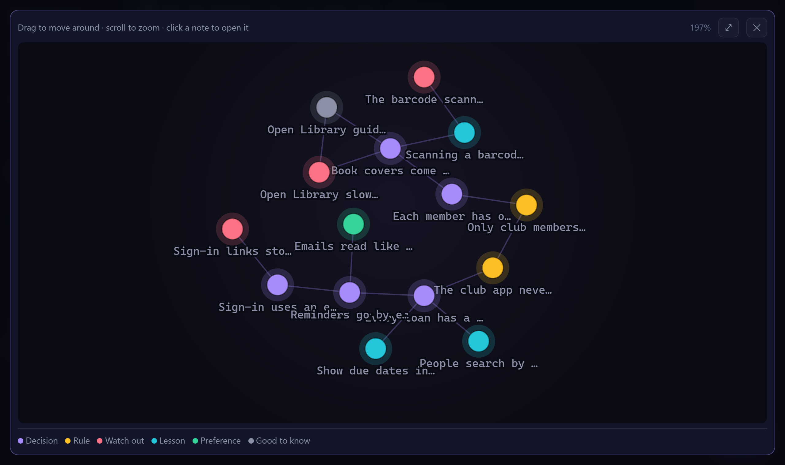
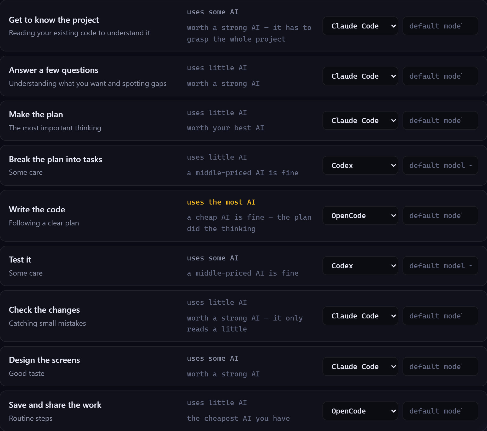

<div align="center">



# Cortex Rail

**An operating system for AI software development,<br />with a free desktop app to run it.**

Your AI coding agents plan first, wait for your approval,<br />and share a project memory that never forgets.

[](https://github.com/AgileCrafts/agent-os-dashboard-dist/releases/latest)


[Install](#install) · [How it works](#how-it-works) · [What you get](#what-you-get) · [Supported AIs](#supported-ais) · [License](#license)

<br />



</div>

<br />

## Why

AI coding agents are fast, and they drift fast. They skip the plan, forget what was decided last week, and change things nobody asked for. The usual fix is more documents and more prompts, which the agent then half-reads at your expense.

Cortex Rail puts the agent on a rail instead. There is one path from idea to release. The agent cannot write code before you approve the plan, and everything it learns along the way is kept where the next session — or the next teammate, or a different AI — will find it.

## Install

**Windows** — paste into PowerShell:

```powershell
irm https://github.com/AgileCrafts/agent-os-dashboard-dist/releases/latest/download/install.ps1 | iex
```

**Linux** — paste into a terminal:

```sh
curl -fsSL https://github.com/AgileCrafts/agent-os-dashboard-dist/releases/latest/download/install.sh | sh
```

That is the whole setup. Both lines:

- install into your own folders, with no administrator rights;
- check the download against its published fingerprint;
- add Cortex Rail to your app menu and open it.

The app keeps itself up to date. Already have Node.js? `npx @agilecrafts/agent-os-dashboard` works too.

## How it works



1. **Open a project.** Pick any folder. Cortex Rail adds a small set of rules to it — plain text files your AI tools read.
2. **Say what you want.** Describe the product in the chat. The AI asks its questions in plain words, then writes the plan and the task list.
3. **Approve.** Until you say yes, the AI is blocked from writing code. This is a lock enforced by the tools themselves, not an instruction the AI can talk its way around.
4. **Build.** The AI works through the tasks one at a time. You watch the board move and can stop, steer or take over at any point.
5. **Come back any time.** Tomorrow, next month, on another computer or with a different AI, the project knows where things stand and why.

## What you get

### One chat that runs everything

Start work, approve a plan, check progress, answer the AI's questions — all from one chat, in plain words. There are no commands to memorise and nothing to watch in a terminal unless you want to.



### A project memory that never forgets



- **It writes things down.** Decisions, rules, pitfalls and lessons are saved as short notes inside your project. When a task is done, the AI records what it learned — and every save can be undone.
- **It finds the right note by meaning.** Before each message, the notes that matter are picked out and handed to the AI. You stop repeating yourself, and the AI stops re-reading everything.
- **It stays on your computer.** The search runs locally. Your notes are not sent anywhere to be searched.
- **It knows when it might be wrong.** Notes about code that has since changed are marked, so the AI checks before trusting them.
- **It tidies itself.** Old notes are put away automatically, so the working set stays small.
- **You can see it.** Browse the notes as a list, or as a map of how they connect.

### The right AI for each step

Planning is short but decides everything. Writing the code is long but only follows the plan. So put your strongest AI on the thinking and a cheaper one on the typing — and a different one again to check the result.



You choose the AI for every step; the app never picks for you. Whichever ones you use, they follow the same rules and share the same memory, so a task planned by one can be built by another and checked by a third.

### Lower AI bills

Each step loads only what it needs, not the whole history of the project. Long projects stay cheap to work on, and the board shows what the work has cost so far.

### A plan sized to the project

A quick demo gets a light plan and a quick check. A product that handles real users and real data gets the full treatment: deeper planning, more testing, more approval points. You pick the size; the quality rules stay the same.

### Built for teams

See who is on which task. Get a heads-up before two people start the same thing. Pick up where a teammate stopped from a short handoff note, with no meeting.

### A live view of the work

A board that moves as the AI works, terminals you can watch or type into, and a list of every change made to your code.

### Yours, on your computer

Cortex Rail runs locally. There is no Cortex Rail account and no Cortex Rail server holding your code. Your AI tools keep using their own sign-ins.

## Supported AIs

Use one, or mix them. Cortex Rail finds the ones you have installed and can help you add the rest.

| | | | |
| :-- | :-- | :-- | :-- |
| Claude Code | Codex | OpenCode | Gemini CLI |
| Qwen Code | Cursor CLI | GitHub Copilot CLI | Aider |

## What gets added to your project

| Added | What it is |
| :-- | :-- |
| `.agent-os/` | The rules your AI tools follow. Plain text. |
| `documents/` | The plan, the task list and the memory notes. |
| A few small pointer files | They tell each AI tool where the rules are. |

Read them, keep them in git with the rest of your project, and change the rules to suit how you work.

## Requirements

- Windows 10 or 11 (64-bit), or 64-bit Linux — Ubuntu 20.04+, Debian 11+, Fedora 34+ and similar.
- At least one supported AI coding tool. Cortex Rail can help you install and sign in to them.

## Removing it

<details>
<summary>Windows</summary>

```powershell
& ([scriptblock]::Create((irm https://github.com/AgileCrafts/agent-os-dashboard-dist/releases/latest/download/install.ps1))) -Uninstall
```

</details>

<details>
<summary>Linux</summary>

```sh
curl -fsSL https://github.com/AgileCrafts/agent-os-dashboard-dist/releases/latest/download/install.sh | sh -s -- --uninstall
```

</details>

Your projects are never touched.

## Problems and ideas

Found a bug, or want something added? [Open an issue](../../issues). Say what you did, what you expected and what happened. A screenshot helps.

## License

Cortex Rail is free to use, for personal and commercial work. The app itself is not open source. The rules it adds to your projects are yours to read and change. Full terms: [LICENSE.md](LICENSE.md).

<div align="center">
<br />
Made by <a href="https://agilecrafts.com">AgileCrafts</a>
</div>
